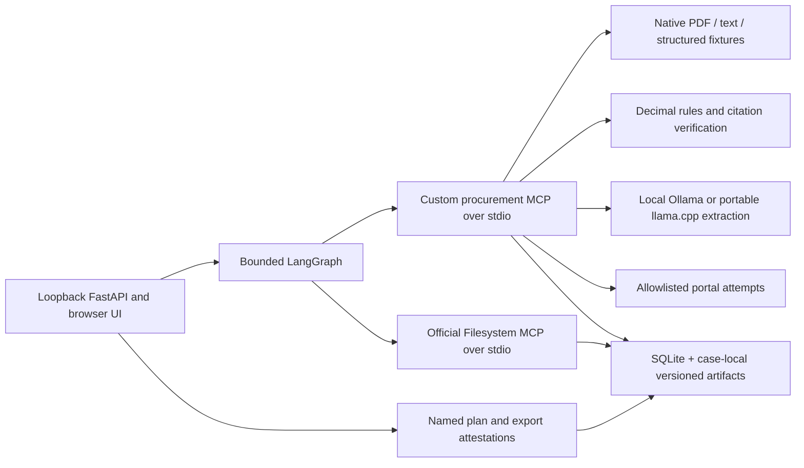

# Architecture

**Implemented MVP:** a local evidence workbench for a public-sector committee reviewing a closed health commodity tender and synthetic bids. The award remains outside the application.

**Agent shape:** one graph compiles a plan, interrupts for named review, reads the case manifest through borrowed MCP, evaluates evidence, validates citations, drafts, and interrupts for export. Built tools: `register_case`, `compile_evaluation_plan`, `evaluate_bid_pack`, and `draft_evaluation_file`. The UI uses actual MCP transport. Approval methods are deliberately absent from the MCP server.

**Borrowed:** official Filesystem MCP receives only the active case root. Existing path validation is preferable to duplicating a filesystem server. A 13.52-second integration test exercised `read_text_file` and all four custom tools with explicitly simulated test approvals.

**Evidence and rules:** original hashes are rechecked at tool boundaries. Criteria require exact cited wording; bids cannot introduce rules. Addenda deactivate superseded criteria. Deterministic expected values, currencies, and rounding must occur in the cited wording. Every finding requires validated citations. Decimal computations preserve submitted prices. Missing FX rules, malformed documents, ambiguous equivalents, and competing evidence abstain.

**Storage and approval:** SQLite persists cases and append-only hash-linked audit events. Case-local versioned files retain originals, manifests, plans, evaluations, drafts, and approvals. A lock binds to a plan digest; export approval binds to the draft digest. Changed inputs/drafts block continuation. Approved ZIPs include an unsigned HTML report, matrix, evidence/price/exception files, original sources, and complete logs. Administrator tampering is outside the demo trust boundary.

**Model and sources:** local Ollama and portable llama.cpp adapters record model/runtime identity, prompt, and usage. They propose sourced manual criteria; arithmetic/approval stay outside the model. The portable runtime was blocked by Windows Application Control before inference; no successful open-model run is claimed yet. Public source attempts retain timestamps/status but cannot establish a registry match without verified records. Native extraction and table boxes work; OCR is unconfigured, with an observed scanned-page failure. Weighted scoring is unsupported.

**Persistence and scope:** graph checkpoints are in memory; durable case state reconstructs gates after restart. Edits retain previous runs, require a new lock, and currently rerun the whole case. The loopback browser uses session-token/origin/host checks; reviewer names are local demo attestations, not enterprise authentication. No winner, award, signature, bidder communication, live procurement, or real unpublished bid is produced.
