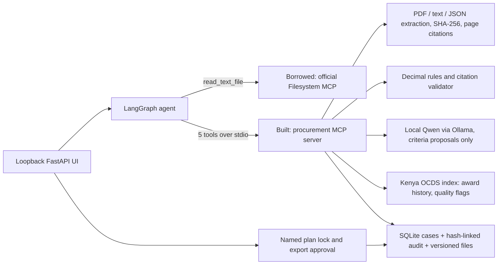

# Architecture

A local agent that prepares a cited evaluation file for a health commodity tender committee and stops at two named-human gates. The award decision is outside the system.

## Agent shape

One LangGraph graph with a conditional route, a retry loop and two `interrupt` gates:

| Node | Behaviour |
| --- | --- |
| inspect | Reads the case manifest through the borrowed Filesystem MCP. A rule-based planner picks steps (model or fixture extraction, award history if a reference OCID is linked, documents needing recovery) and logs each reason. Falls back to the local store if the borrowed server fails. |
| compile | Calls `compile_evaluation_plan`. On a validation error, loops back with the error as feedback, up to 3 attempts with a model and 1 without. Then routes to `needs_human`. |
| needs_human | Sets `HUMAN_RECOVERY_REQUIRED` with the reason. Nothing is invented. |
| award_history | Calls `search_award_history`; a failure is logged and the run continues to the gate. |
| plan_gate | Interrupts until a named person locks the exact plan digest. |
| evaluate, draft | `evaluate_bid_pack`, then `draft_evaluation_file`. |
| export_gate | Interrupts until a named person approves the exact draft digest. |

The planner is deterministic on purpose: a 1.5B CPU model is not trusted to choose tools, and a rule leaves an auditable reason. The model's only job is proposing quoted criteria, which code verifies.

## MCP servers: built and borrowed

**Built** (`mcp_server/server.py`, Python FastMCP, stdio): `register_case`, `compile_evaluation_plan`, `search_award_history`, `evaluate_bid_pack`, `draft_evaluation_file`. Each writes a versioned artifact; four of them write case files. `search_award_history` is reusable without a case: give it an OCID or keywords and it returns cited awards from any OCDS JSONL index built by `connectors/ocds.py`, so it should work for the other eight African publishers on the same schema (only Kenya tested). Approval is deliberately not an MCP tool.

**Borrowed:** official `@modelcontextprotocol/server-filesystem` 1.0.0, given only the active case folder. Its path validation and symlink handling are maintained upstream; a home-made file server would be new attack surface.

## Evidence rules

- Every criterion must quote its source page exactly; bids cannot introduce criteria; an addendum may supersede a criterion only if its quotation names it.
- Every finding needs at least one validated citation (schema-enforced). Missing, corrupt, ambiguous or competing evidence becomes `UNRESOLVED`, never an adverse flag.
- Submitted prices are preserved; Decimal arithmetic records discrepancies; currency conversion needs a published rule.
- Public award data is context: it adds no criteria and no supplier findings. Each value cites file hash, line, OCID, release and JSON pointer. Contact details are dropped at index time.

## Storage, audit and approvals

SQLite holds cases and an append-only, hash-chained audit log (database triggers block update and delete). Every tool call, retry, plan decision, borrowed read and approval is an event with inputs, outputs, timestamps and status. A plan lock binds the plan digest; export approval binds the draft digest; changed sources or drafts block continuation. The exported ZIP carries the unsigned report, matrix, evidence, award history annex, original sources and the complete log.

## Known limits

No OCR. Graph checkpoints are in memory (case state rebuilds gates after restart). Reviewer names are local attestations, not authentication. Registry lookups are unresolved stubs. See README "Not finished".
