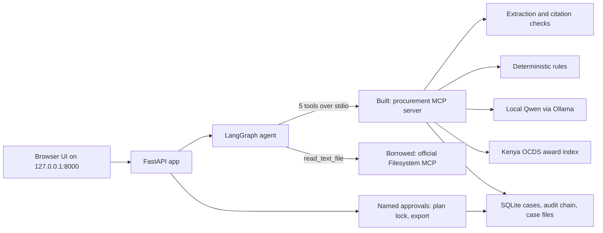

# Technical guide

This guide explains how every part of the Health Commodity Tender Workbench works: the agent loop, the MCP servers and tools, each processing stage from registration to export, the evidence rules, the public-data index, the local model, and how to run and test it. README.md is the short version; ARCHITECTURE.md is the one-page summary; EVALS.md holds the measurements.

## 1. Purpose

A public tender evaluation committee for health products (for example a Kenya Medical Supplies Authority ad hoc committee) spends weeks sorting bids, ticking documents, checking bidders, comparing prices and writing the evaluation report. The workbench prepares that file in minutes and then stops:

- it compiles the published evaluation criteria, each quoted from its source page;
- it checks every bid against the criteria a named person has locked;
- it checks price arithmetic without changing any submitted figure;
- it attaches the tender's public award history from Kenya's open contracting data;
- it drafts an unsigned report whose recommendation, signature and award fields stay blank.

Two named-human gates (plan lock and export approval) sit between the agent and anything consequential. The award decision never enters the system.

## 2. Repository map

| Path | Role |
| --- | --- |
| `app/server.py` | FastAPI app on 127.0.0.1:8000: UI, local session token, origin and host checks, case API |
| `app/static/` | Browser UI (plain HTML, CSS and JavaScript, no build step) |
| `orchestrator/workflow.py` | LangGraph agent: planner, retry loop, gates, routing |
| `orchestrator/mcp_client.py` | MCP clients: starts the procurement server and the borrowed Filesystem server over stdio |
| `orchestrator/store.py` | SQLite case store, write-once case files, hash-chained audit log, path guard |
| `mcp_server/server.py` | The built MCP server (FastMCP, stdio) exposing five tools |
| `mcp_server/service.py` | Tool implementations and the audit decorator |
| `mcp_server/schemas/models.py` | Pydantic models: Citation, Criterion, Plan, Finding, ProductLine, CaseRequest, ApprovalRequest |
| `document_pipeline/extract.py` | Native PDF, text and JSON extraction; citation verification |
| `rules/checks.py` | Deterministic checks: present, exact, minimum, expiry, arithmetic |
| `connectors/local_model.py` | Local model adapters (Ollama, llama.cpp) with endpoint restrictions |
| `connectors/ocds.py` | Kenya OCDS index builder and award-history search |
| `connectors/public_sources.py` | Allowlisted registry lookups (currently unresolved stubs) |
| `prompts/criteria-v1..v4.txt` | Prompt history; v4 is current |
| `sample_case/fixture.py` | Original synthetic tender, addendum and three bids |
| `scripts/` | Start scripts, OCDS fetch, smoke run, model evaluation, demo case preparation |
| `tests/` | 50 automated tests, including one strict expected failure |

## 3. Architecture



Every agent step that touches case data is an MCP tool call. Each call starts a fresh server subprocess, so tool state lives only in the case store, never in server memory. Approvals are not MCP tools: only the UI can lock a plan or approve an export.

## 4. The agent loop

The graph is defined in `orchestrator/workflow.py` and compiled with an in-memory checkpointer.

### 4.1 State

`case_id`, `model`, `live_sources`, `work_plan` (list of step names), `attempt_limit`, `attempts`, `feedback`, `compile_error`, `plan_id`, `draft_id`.

### 4.2 Nodes and routing

| Node | What it does | Next |
| --- | --- | --- |
| start route | Reads the case from the store: a draft exists, go to export gate; a plan exists, go to plan gate; otherwise inspect | inspect, plan_gate or export_gate |
| inspect | Reads the case manifest through the borrowed Filesystem MCP. Runs `plan_work` and saves the work plan with reasons. If the borrowed server fails, plans from the local store and records that | compile |
| compile | Calls `compile_evaluation_plan`. On a tool error, records an `agent.recovery` event and stores the error as feedback | conditional |
| after compile | No error: award_history if the work plan lists it, otherwise plan_gate. Error with attempts left: compile again. Error with no attempts left: needs_human | |
| needs_human | Sets case state `HUMAN_RECOVERY_REQUIRED` with the reason and attempts | end |
| award_history | Calls `search_award_history` for the case. A failure is logged as SKIPPED and the run continues | plan_gate |
| plan_gate | LangGraph `interrupt` until the plan is locked by a named reviewer | evaluate |
| evaluate | Calls `evaluate_bid_pack` with the locked plan ID | draft |
| draft | Calls `draft_evaluation_file` | export_gate |
| export_gate | `interrupt` until a named reviewer approves this exact draft | end |

### 4.3 The planner

`plan_work(manifest, model)` is deterministic and its output is written to the audit log:

- Always plans `compile_evaluation_plan`.
- If tender or addendum files are not structured JSON and no model is selected, it records that compilation will stop for human source recovery.
- With a model, the attempt limit is 3; without, 1.
- If the case links a public reference (`reference_ocid`), it adds `search_award_history`.
- It lists extraction warnings (`OCR_FAILED`, `MISSING_DOCUMENT`) that will remain unresolved.
- The remaining steps are fixed: named plan approval, evaluate, draft, named export approval.

The model does not choose tools. A 1.5B CPU model is not reliable at tool selection, and a rule leaves a reason a committee can read.

### 4.4 Retry and recovery

When compilation fails (for example the model quoted text that is not on the cited page), the next attempt passes the validator's message to the model as `feedback`. After the limit the agent stops in `HUMAN_RECOVERY_REQUIRED`. Other recoveries: the borrowed server failing (local manifest used), the OCDS index missing (`SOURCE_UNAVAILABLE` recorded), and an award-history call failing (skipped, logged). No recovery path invents criteria or findings.

### 4.5 Resuming

The UI calls `POST /api/cases/{id}/advance` for every step. `Workflow.advance` uses one graph thread per plan revision (`case_id:revision:N`), resumes an interrupted thread with `Command(resume=True)`, or starts a fresh run with attempts reset. Checkpoints are in memory; after a restart the start route rebuilds the position from the case store.

## 5. MCP

### 5.1 Built server: `mcp_server/server.py`

Python FastMCP over stdio, started as `python -m mcp_server.server`. Every tool method is wrapped by the `audited` decorator in `service.py`, which logs a STARTED event, then SUCCESS (with duration) or ERROR (with type and message). Uploaded file contents are logged as SHA-256 and length, never as raw bytes.

| Tool | Inputs | Output | Effect |
| --- | --- | --- | --- |
| `register_case` | Case request: name, operator, closing date and source, optional reference OCID, documents (base64, kind, bidder ID, synthetic flag) | Case record with document hashes, page extraction and warnings | Writes original files and `manifest-v1.json`; creates the case |
| `compile_evaluation_plan` | case_id, optional model tag, optional feedback | Draft plan: criteria, source citations, digest, revision | Writes `plans/<id>.json` and, with a model, the raw proposal |
| `search_award_history` | OCID or title keywords, optional buyer and limit, optional case_id | Cited award records, quality flags, statistics; with a case, an annex with observations | With a case, writes `references/<id>.json` |
| `evaluate_bid_pack` | case_id, locked plan ID, live_sources flag | Run: findings, price rows, external checks, versions | Writes `runs/<id>.json` |
| `draft_evaluation_file` | case_id | Draft record: file hashes and digest | Writes the draft folder (report, matrix, ledger, prices, unresolved items, annex) |

Errors are raised as tool errors (`isError`), which the client turns into `ValueError` and logs as `mcp_transport:<tool>` events.

### 5.2 Client: `orchestrator/mcp_client.py`

`procurement(store, tool, arguments)` starts the server subprocess with the case root in its environment, initializes an MCP session, calls the tool and parses structured content. Timeouts: 660 s for a model compilation, 180 s otherwise.

### 5.3 Borrowed server: official Filesystem MCP

`@modelcontextprotocol/server-filesystem` 1.0.0, pinned in `package-lock.json`, started with node and given only the active case folder as its allowed root. The agent calls `read_text_file` on `manifest-v1.json` and checks that the manifest's ID matches the case. Reason for borrowing: its path validation and symlink handling are maintained upstream, while a home-made file server would be new attack surface.

### 5.4 Reusing the tools

`search_award_history` works without a case: any MCP client can query an OCDS index by OCID or keywords. The index builder reads standard OCDS JSON lines, so it should work for the other African publishers on the same schema; only Kenya is tested.

## 6. Process walkthrough

### 6.1 Registration (`register_case`)

1. Validates the request: closing date before today (Nairobi time); at least one tender and one bid; every bid labelled synthetic with a bidder ID; 2 to 50 documents; simple filenames; PDF, JSON, TXT or Markdown only; 25 MB per file and 100 MB per case.
2. Writes each original under `documents/doc_NNN.ext` (write-once) and records its SHA-256.
3. Extracts text per type:
   - JSON: one page holding the pretty-printed object, plus the structured object for field lookups.
   - TXT and Markdown: pages split on form feeds.
   - PDF: signature check, encrypted files refused, at most 250 pages; pdfplumber text and table bounding boxes per page; a page with no native text is marked `OCR_FAILED`.
   - A parser failure is recorded as a `MISSING_DOCUMENT` warning, never as a finding.
4. Writes the manifest (everything except extracted text) for the borrowed server to read.

### 6.2 Planning (`inspect` node)

Covered in 4.3. The UI shows the plan under "Agent work plan" on the Case files page.

### 6.3 Compilation (`compile_evaluation_plan`)

Structured fixture path: criteria come from the synthetic tender's JSON. Each becomes a criterion with a citation (document, hash, page 1, section, exact wording).

Model path: `compile_with_model` sends one tender or addendum document per request (section 9). Each proposed criterion is then:

1. checked to cite a registered tender or addendum (never a bid);
2. bound to that document's hash from the trusted manifest, not from the model;
3. given wording equal to its quotation;
4. set to method `manual` with no field, expected value or weight, so a person must map any deterministic check.

Both paths then run `_validate_plan`:

- every citation quote must occur on the cited page of the cited document hash;
- bids cannot introduce criteria;
- wording must equal the quotation;
- supersession only from an addendum whose quote names the replaced criterion ("replacing criterion T01");
- `minimum` and `exact` expected values must appear in the wording;
- arithmetic rules may only use currency, rounding and FX values that appear in the wording;
- an inactive criterion needs a valid supersession link, and a superseded criterion must be inactive;
- IDs unique, at least one active criterion, weighted scoring refused.

The plan gets a revision number and a SHA-256 digest. Editing in the UI (`revise_plan`) creates a new revision, clears the evaluation and draft, and needs a new lock.

### 6.4 Award history (`search_award_history`)

Covered in section 8. The closing-date observation appears as a warning on the plan page before the plan can be locked.

### 6.5 Plan lock (UI only)

`approve_plan` requires a reviewer name of at least two characters, a ticked confirmation, and the exact current plan digest. It re-validates the plan, records the approval, and writes `approvals/<id>.json`. A stale digest or an already locked plan is refused.

### 6.6 Evaluation (`evaluate_bid_pack`)

Refuses anything but the current locked plan and re-checks every source hash. Then, for each bidder and each active criterion:

| Situation | Result |
| --- | --- |
| More than one bid document supplies the field | UNRESOLVED: competing evidence |
| No value, and a parser failed, extraction is incomplete or the method is manual | UNRESOLVED: absence cannot be established |
| No value in a fully parsed structured bid | UNSUPPORTED: cites the requirement and every bid page that was searched |
| One value, method `present` | SUPPORTED (authenticity not established) |
| One value, method `exact` | SUPPORTED on case-insensitive match, otherwise UNRESOLVED for human judgement of equivalence |
| One value, method `minimum` | Decimal comparison: SUPPORTED or UNSUPPORTED |
| One value, method `expiry` | Date compared with the declared closing date |
| One value, method `arithmetic` | Price check per product line (section 7) |

Every finding is a Pydantic `Finding` that requires at least one citation, and every citation is re-verified against its page. Registry lookups (Pharmacy and Poisons Board, debarment, KEML, price index) return UNRESOLVED unless `live_sources` is set. Even then only allowlisted hosts are contacted, with redirects disabled and a 2 MB cap, and a portal response never counts as a registry match.

### 6.7 Draft (`draft_evaluation_file`)

Requires an evaluation against the current locked plan and re-verifies all citations. Writes:

- `evidence-ledger.json`: plan, run, approvals, warnings, award history, blank recommendation, signature and award fields;
- `report.html`: escaped, sandboxed when previewed, with an evidence table, price observations, reference checks, award history, and blank decision lines;
- `compliance-matrix.csv`: cells that start with `= + - @` are prefixed to block spreadsheet formula injection;
- `price-observations.json`, `unresolved-items.json` (non-supported findings, reference checks, award-history observations), `public-award-history.json`.

The draft digest is the hash of the file-hash manifest.

### 6.8 Export (UI only)

`export_draft` requires the exact draft digest and re-hashes every draft file, so a draft edited after review cannot be exported. It records the approval, then builds a ZIP with the draft files, `file-manifest.json`, `approvals.json`, the tool log, the raw model proposal (hash-checked), the original source documents, and finally `complete-tool-log.json`. Download is refused until the case is `EXPORTED`.

## 7. Deterministic rules (`rules/checks.py`)

`financial_check(line, rule)` per product line:

- calculated extended price = quantity times submitted unit price, rounded half-up to the published increment;
- normalized price = unit price divided by pack size (for example KES per mL);
- `discrepancy` when the calculated and submitted totals differ; the submitted values are kept as submitted;
- a different currency needs an FX rule with rate, date, source and method `multiply`, all quoted in the criterion; without one the row is UNRESOLVED.

All arithmetic uses Python `Decimal`. Non-finite or non-positive rates are refused.

## 8. Public data: Kenya OCDS award history (`connectors/ocds.py`)

### 8.1 Source

Kenya Public Procurement Regulatory Authority data from the Public Procurement Information Portal, republished by the Open Contracting Partnership Data Registry (publication 147). `scripts/fetch_ocds.py` downloads the 2024 and 2025 gzipped JSON-lines files (about 16 MB) into ignored `local_data/ocds/`, records URL and retrieval time, and builds `kenya-ppra.sqlite` (about one minute). The registry lists no licence for this publication, so the data is never committed.

### 8.2 Index

One row per contracting process: OCID, release ID and date, buyer, tender title, tender period start and end, method, category, and awards (ID, title, amount, currency, supplier IDs and names, contract period). The file name and line number are kept for citations. Party records are not indexed at all, because they carry personal contact points. The builder also stores each file's SHA-256, the 99th percentile of positive award amounts, and counts of party identifier schemes.

### 8.3 Search and flags

Exact OCID, or up to six title keywords combined with AND, with an optional buyer filter and a limit of 1 to 50. Flags:

| Flag | Meaning | Effect on statistics |
| --- | --- | --- |
| `SUPPLIER_NAME_HAS_LIST_NUMBER` | Published name starts with a list number, such as `17.\tLaboratory & Allied Ltd` | None: name normalized, published name kept |
| `AWARD_VALUE_ZERO` / `AWARD_VALUE_MISSING` | No usable amount | Excluded |
| `AWARD_VALUE_ABOVE_DATASET_P99` | Above the dataset's 99th percentile | Excluded |
| `TENDER_PERIOD_INVERTED` | Tender period starts after it ends | Shown on the record |

Statistics (count, total, quartiles) use only awards without value flags and only when one currency is present. Every record and award cites dataset, file, file SHA-256, line, OCID, release ID and JSON pointer (for example `/awards/3` or `/tender/tenderPeriod/endDate`). Supplier identifiers use the portal's internal `Bidders` scheme, so no identity matching is attempted. The publication has no item lines, so no unit-price benchmark is produced.

### 8.4 With a case

The case's `reference_ocid` is searched. If the published closing date differs from the declared one, a `CLOSING_DATE_DISCREPANCY` observation (status UNRESOLVED, with both dates and the citation) is saved in the annex and carried into the draft. For the reference KEMSA/OIT05/2024-2026, the archive page says 12 November 2024 and the OCDS record says 13 November 2024. The record shows eight awards totalling KES 45,188,853.

## 9. Local open-weights model (`connectors/local_model.py`)

- **Runtime:** Ollama (default) or llama.cpp's HTTP server. The endpoint must be plain HTTP on a loopback address with no credentials, path or query. Cloud model tags and remote aliases are refused before any document text is sent. Ollama models must report local GGUF metadata; llama.cpp must serve the exact pinned file.
- **Model:** Qwen2.5-1.5B-Instruct Q4_K_M, publisher checksum verified, imported as `tender-qwen:1.5b-q4`. `start.ps1 -WithOllama` installs a signature-checked Ollama on port 11435 with cloud features off.
- **Request:** one tender or addendum document per request, prompt `criteria-v4`, JSON-schema-constrained output (document ID restricted to that document; `supersedes` forced to null for the original tender), temperature 0, 16,384-token context, at most 5,000 output tokens, a shared 600 s budget, CPU only. Source text is capped at 100,000 characters.
- **Checks:** truncated or incomplete output is refused, and the output must validate against the proposal schema. Feedback from a rejected attempt is appended to the system prompt.
- **Records:** runtime and version, model digest and details, prompt and schema hashes, per-document token counts and durations, correction feedback, and the immutable raw proposal file with its hash.

Measured (EVALS.md): eight complete runs (five on 11 October, three on 15 October 2026), 7/7 gold source spans with correct addendum precedence in each, 100.78 to 225.00 s per workflow, 898 identical output tokens in the three latest runs.

## 10. Storage, audit and security

- **Case store:** `outputs/workbench.sqlite3` holds case records. Case files are write-once (`Store.write` refuses overwrites). Case IDs must match `case_` plus 16 hex characters, and paths are resolved and checked for escapes and symlinks.
- **Audit chain:** each event stores tool, case ID, inputs, outputs, status, call ID, start time, timestamp and duration. Its hash covers the previous hash plus the payload. SQLite triggers abort any UPDATE or DELETE, and `verify_audit` recomputes the chain (shown in the UI's Audit trail).
- **Web app:** loopback only, trusted-host check, a random session token required on every state-changing call, cross-origin requests refused, a strict Content-Security-Policy, and a sandboxed report preview. Reviewer names are local attestations, not authentication; a machine administrator can still edit local files.
- **Data conduct:** closed tenders only, synthetic bids only, no personal details. Embedded instructions in documents are treated as data (a prompt-injection test covers this).

## 11. Running and testing

```bash
./scripts/start.sh                 # macOS, Linux, Git Bash
./scripts/start.sh --check         # tests only
./scripts/start.sh --no-public-data
```

```powershell
./scripts/start.ps1                # Windows
./scripts/start.ps1 -CheckOnly
./scripts/start.ps1 -WithOllama    # also starts the local model
```

| Command | Purpose |
| --- | --- |
| `uv run python -m scripts.fetch_ocds` | Download and index public data (`--refresh` to redownload) |
| `uv run python -m scripts.mcp_smoke` | Full agent run over real MCP transport with simulated approvals |
| `uv run python -m scripts.model_eval --model tender-qwen:1.5b-q4 --native-text --repeats 3` | Measured model workflows |
| `uv run python -m scripts.prepare_model_review` | Model-compiled case left waiting for your approval |
| `uv run python -m scripts.prepare_failure_case` | Case where the agent stops for a human |

Environment variables: `TENDER_CASE_ROOT` (case folder, default `outputs`), `TENDER_LOCAL_MODEL_URL`, `TENDER_LOCAL_MODEL_BACKEND` (`ollama` or `llamacpp`), `TENDER_OCDS_INDEX` (index path).

## 12. Limitations

- No OCR: image-only pages stay `OCR_FAILED` (strict expected-failure test).
- The real KEMSA tender PDFs timed out on download; criteria extraction from real public PDFs is unmeasured.
- Registry checks never return verified records.
- No unit-price benchmark, because the public data has no item lines.
- The retry loop is tested with a simulated failing model; Qwen has not failed validation in a real run.
- `start.sh` is tested under Git Bash on Windows only.
- In-memory graph checkpoints; local reviewer attestations rather than authentication.
